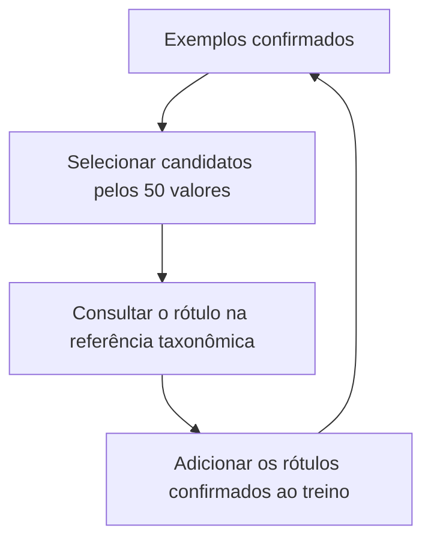

# Como identificamos os morcegos

O desafio era identificar quais das **8.426 linhas** da base da disciplina representam morcegos. Começamos com alguns exemplos conhecidos, usamos as características numéricas para procurar outros candidatos e recorremos à taxonomia para confirmar cada classe. Ao final, medimos quantos morcegos os modelos conseguem reconhecer quando recebem apenas os números.

## 1. Entenda o que há em cada linha

Os dois arquivos têm a mesma ordem. A linha 2291 de [`Names.txt`](../Names.txt) contém `Desmodus_rotundus`. A linha 2291 de [`wpc50.dat`](../wpc50.dat) contém os 50 valores desse organismo, derivados de dados mitocondriais. O número da linha é o índice que aparece nos resultados.

Cada modelo recebe **os 50 valores** como entrada. O nome científico serve para consultar a referência e registrar de qual organismo veio o resultado. O relatório usa PCA, que resume parte da informação em dois eixos para desenhar um gráfico. O treinamento e a busca de candidatos usam as 50 características.

## 2. Prepare a referência e a amostra inicial

Usamos a linhagem no [NCBI Taxonomy](https://www.ncbi.nlm.nih.gov/Taxonomy/Browser/wwwtax.cgi?id=9397) para definir a classe. Quem pertence à ordem **Chiroptera** recebe `1` (morcego). Os demais recebem `0` (outro).

O [`preparar_referencia.py`](../preparar_referencia.py) cruza os nomes da base com uma cópia da taxonomia. A [tabela de referência](../dados/referencia_taxonomica.csv) guarda o índice, o nome original, a classe, o identificador taxonômico (TaxID), o método de correspondência e o link da evidência. Grafias ou identificações que precisaram de revisão específica estão em [`nomes_revisados.csv`](../dados/nomes_revisados.csv).

Para começar a busca, usamos **26 exemplos** já conhecidos na parte de desenvolvimento, sendo 11 morcegos e 15 outros organismos. *Desmodus rotundus* é um exemplo de classe `1`. *Felis catus*, o gato doméstico, é um exemplo de classe `0`. Uma parte da base ficou reservada para medir o desempenho durante as rodadas.

## 3. Procure candidatos em seis rodadas

A cada rodada, ajustamos as escalas dos 50 valores com os exemplos já confirmados. Em seguida, treinamos uma **SVM**, um modelo que aprende uma fronteira entre os dois grupos. Aqui usamos a versão com kernel RBF, que permite que essa fronteira seja curva, e pesos balanceados para dar importância à classe com menos exemplos.

Em cada lote, escolhemos **30 linhas ainda disponíveis**, nesta ordem:

| Quantidade | Como escolhemos | Por que usamos |
| --- | --- | --- |
| 12 | Menor distância até algum morcego já confirmado | Características parecidas podem indicar outro morcego |
| 12 | Pontuações da SVM mais próximas de zero, onde fica a fronteira | Casos próximos da fronteira ajudam a refinar a separação |
| 6 | Sorteio entre as linhas restantes | Permite examinar exemplos fora das duas prioridades |

Na primeira rodada, a vizinhança indicou a linha **6748**, de *Rhinolophus pumilus*. A referência confirmou a classe `1`, e a linha passou a integrar o treino da rodada seguinte. O mesmo processo incorpora candidatos confirmados como classe `0`. A seleção usa os rótulos dos exemplos já conhecidos. Cada rótulo novo é consultado depois que a linha é escolhida.

| Etapa | Rótulos acumulados | Morcegos novos | Morcegos acumulados |
| --- | ---: | ---: | ---: |
| Amostra inicial | 26 | — | 11 |
| Rodada 1 | 56 | 12 | 23 |
| Rodada 2 | 86 | 17 | 40 |
| Rodada 3 | 116 | 13 | 53 |
| Rodada 4 | 146 | 10 | 63 |
| Rodada 5 | 176 | 0 | 63 |
| Rodada 6 | 206 | 0 | 63 |

Dos 52 novos morcegos, **46 vieram pela vizinhança** e **6 pela fronteira da SVM**. O sorteio trouxe exemplos da classe `0`. A [lista de candidatos](../resultados/candidatos.csv) mostra a rodada, o critério e a classe confirmada de cada linha.

## 4. Meça o desempenho

Fizemos duas avaliações que respondem a perguntas diferentes.

1. **As rodadas ajudaram?** Comparamos a SVM de cada rodada na mesma parte reservada. Ela tinha 1.686 linhas, sendo 16 morcegos. A SVM detectou os 16 desde o início. Os falsos positivos caíram de cinco na amostra inicial para zero após a primeira rodada. Essa parte da base ficou fora da busca de candidatos e do treino das rodadas.
2. **Como os modelos se saem na base completa?** Separamos a base rotulada em cinco partes e repetimos o teste cinco vezes. Em cada vez, quatro partes serviram para treinar e uma para testar. O código mantém juntos os registros com o mesmo identificador de espécie quando disponível. Comparamos a SVM com o **k-NN**, que prevê a classe a partir de cinco vizinhos e dá mais peso aos mais próximos.

Na validação cruzada, **cada modelo previu 80 morcegos, acertou 79 e gerou um falso positivo**. Os falsos positivos ocorreram em linhas diferentes. A SVM marcou *Scapanulus oweni* (7013) e o k-NN marcou *Hylomys suillus* (3597).

| Métrica | Pergunta | Resultado de cada modelo |
| --- | --- | ---: |
| Sensibilidade | Dos morcegos confirmados, quantos o modelo encontrou? | 79 de 79 · 100,00% |
| Precisão | Das linhas que o modelo marcou como morcego, quantas estavam certas? | 79 de 80 · 98,75% |
| Acurácia | De todas as linhas, quantas foram classificadas corretamente? | 8.425 de 8.426 · 99,99% |

Como há poucos morcegos na base, a regra de marcar todas as linhas como `0` acerta **99,06%** e perde os 79 morcegos. A sensibilidade mostra esse problema. Os resultados se referem à base da disciplina.

## 5. Confira a entrega e reproduza o experimento

- [`classificacao.csv`](../resultados/classificacao.csv) contém **79 morcegos e 8.347 outros organismos**, com os rótulos confirmados na ordem da base original.
- [`indices_morcegos.txt`](../resultados/indices_morcegos.txt) lista os 79 índices positivos, um por linha.
- [`previsoes_validacao.csv`](../resultados/previsoes_validacao.csv) permite comparar as previsões de cada modelo com a classe confirmada.
- [`rodadas.csv`](../resultados/rodadas.csv), [`metricas.csv`](../resultados/metricas.csv) e o [relatório](../relatorio_morcegos.pdf) registram os testes.

Para reproduzir o experimento, rode [`classificar_morcegos.py`](../classificar_morcegos.py) seguindo as [instruções do README](../README.md#executar). A tabela taxonômica usada no trabalho já está incluída.
